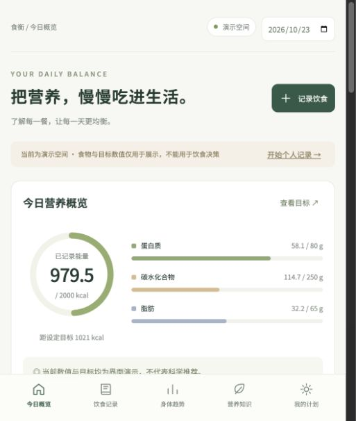

# BetterBody

**Local-first nutrition tracking, with transparent food estimates and optional photo recognition.**

BetterBody (食衡 / Shiheng) is a responsive, Chinese-language web app for recording meals, reviewing daily nutrient intake, and tracking body metrics. It runs on Node.js without third-party runtime dependencies. Version **0.4.0** targets single-user, self-hosted use.



## Features

- Create and edit meal records, adjust portions, and review daily nutrient totals.
- Break mixed dishes into ingredients, with optional gram weights and detailed nutrient fields.
- Keep missing nutrient values unknown instead of silently treating them as zero.
- Capture or select a photo, review upload consent, and confirm estimated ingredients and portions before saving.
- Connect a server-side vision provider using OpenAI Responses or a Chat Completions compatible protocol.
- Look up nutrient candidates in USDA FoodData Central, retaining source identifiers and checking units.
- Record body metrics, mood, and sleep; import supported body-metric JSON files.
- Store records in the browser and export JSON backups. Restore merges supported meal summaries and metrics; recipe details, targets, and journal entries are not restored.
- Use a responsive interface with reduced-motion/transparency support, an app manifest, and static offline caching.

## Quick start

Requires **Node.js 22.12 or later** and npm. No dependency installation or build step is needed.

```sh
git clone https://github.com/bladedragon/BetterBody.git
cd BetterBody
cp .env.example .env
npm start
```

Open [localhost:4173](http://localhost:4173). The server reads `.env` automatically and binds to `127.0.0.1` by default. Manual recording works without provider keys. External API calls remain disabled until explicitly enabled.

The interface distinguishes demonstration data from personal records. Demo nutrients illustrate interactions and are not a verified food database.

## Optional photo recognition

1. Add vision-provider credentials and a USDA FoodData Central API key to the private `.env` file.
2. Configure the provider protocol, endpoint, and model as described in [Integrations](docs/integrations.md).
3. Set `LIVE_CALLS_ENABLED=true` and restart the server.
4. Capture or select an image, consent to uploading it, and review the results before saving.

Vision output supplies estimated ingredients and weight ranges. Nutrient values come from database candidates or manual corrections. Photos cannot reliably measure portion weight, hidden oils, or uneaten food.

Keys stay on the server. Images are processed in memory; provider retention policies still apply once an image is uploaded. See [provider configuration](docs/providers.md) and [deployment and privacy](docs/integrations.md#deployment-and-privacy).

## Development and validation

```sh
npm run check   # JavaScript syntax checks
npm test        # Domain, storage, adapter, and HTTP tests
npm run test:ui # Start a fixed-response UI fixture at localhost:4180
```

The UI fixture is an interactive test server, not an automated browser test. It uses fixed responses and no live provider calls. Automated tests do not establish real-world recognition accuracy. See [Verification](docs/verification.md).

## Deployment

For local use, run `npm start`. For access beyond loopback, configure an HTTPS reverse proxy, `APP_ORIGIN`, and an `APP_PASSWORD` of at least 16 characters. The Basic Auth username is `shiheng`. Container deployments also require `HOST=0.0.0.0`; the included [Dockerfile](Dockerfile) uses port 4173.

Records remain in each browser; the server does not provide accounts or cross-device synchronization. Export backups before clearing browser storage. Static offline caching does not make provider APIs available offline.

## Project structure

| Path | Purpose |
| --- | --- |
| `src/` | Browser UI, camera flow, nutrient calculations, portions, and local storage |
| `backend/http.mjs` | HTTP routes, access checks, request limits, and static asset allowlist |
| `backend/recognition.mjs` | Vision-provider and USDA adapters |
| `server.mjs` | Environment loading and server startup |
| `tests/` | Deterministic tests and synthetic upload fixture |
| `scripts/` | Syntax checks and the isolated UI fixture server |
| `examples/` | Synthetic import data and adapter example |
| `docs/` | Product scope, integrations, and verification guidance |

## Scope and limitations

This release is a self-hosted web application. Native mobile/desktop packages, multi-user accounts, cloud synchronization, nutrition-label OCR, background push notifications, and professionally reviewed personalized plans are not implemented. Real device cameras, live providers, container deployment, and public HTTPS deployment require environment-specific acceptance testing.

Nutrition estimates and intake summaries are informational and do not diagnose nutrient deficiencies or other health conditions.

## Contributing

Keep changes focused, document behavior changes, and run `npm run check` and `npm test` before submitting a pull request. Never commit credentials, browser exports, personal health records, local tooling configuration, or generated dependencies. `.env.example` is a public template and must contain placeholders only.
